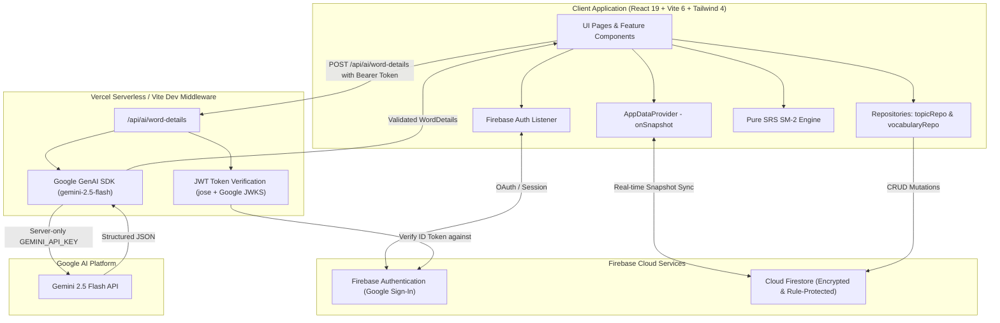

# Vocabloom

<p align="center">
  <strong>A modern, AI-powered personal English vocabulary trainer featuring Spaced Repetition (SM-2), interactive flashcards, quizzes, and real-time cloud synchronization.</strong>
</p>

<p align="center">
  
  
  
  
  
  
  
</p>

---

## Table of Contents

1. [What is Vocabloom](#1-what-is-vocabloom)
2. [Architecture & System Design](#2-architecture--system-design)
3. [Environment Variables](#3-environment-variables)
4. [Firebase Project Setup](#4-firebase-project-setup)
5. [Firestore Schema & Data Models](#5-firestore-schema--data-models)
6. [Local Setup & Development](#6-local-setup--development)
7. [Vercel Deployment](#7-vercel-deployment)
8. [Testing & Quality Assurance](#8-testing--quality-assurance)
9. [Firestore Rules Deployment](#9-firestore-rules-deployment)
10. [AI Architecture & Security Pipeline](#10-ai-architecture--security-pipeline)

---

## 1. What is Vocabloom

**Vocabloom** is a single-page web application designed for personal English vocabulary learning and long-term retention. It combines the power of **Google Gemini AI** for automatic word lookups with a scientific **Spaced Repetition System (SRS)** inspired by SuperMemo SM-2.

### Key Features

- **AI-Powered Vocabulary Lookup**: Automatically fetch Vietnamese definitions, part of speech, and IPA phonetic transcriptions with a single click using Gemini 2.5 Flash.
- **Spaced Repetition System (SRS v1)**: Algorithmically schedules review intervals based on learning feedback (**Again**, **Hard**, **Good**, **Easy**), tracking ease factors, repetitions, and lapses across 5 mastery levels (Level 0 to 4).
- **Interactive Flashcards & Quizzes**:
  - **Flashcards Mode**: 3D flip card animations, Text-to-Speech (TTS) pronunciation audio, and instant SRS rating.
  - **Multiple-Choice Quiz Mode**: AI/dictionary-generated distractors with immediate scoring and session summary analytics.
  - **Review Queue**: Dedicated SRS Due Review mode filtering words scheduled for today or earlier.
- **Topic Organization & Filtering**: Create and manage custom topics with full CRUD operations, topic filtering, and word counters.
- **Cloud Sync & User Isolation**: Full real-time synchronization with Firebase Authentication and Cloud Firestore, protected by granular security rules.
- **Mobile-First & Fluid UX**: Responsive layout tailored for mobile, tablet, and desktop viewports, dark mode support, and smooth Motion animations.

---

## 2. Architecture & System Design

Vocabloom is built as a single-page application (SPA) with a serverless API backend for secure AI operations.

### High-Level Architecture Diagram



### Technology Stack

| Layer | Technology / Library |
| :--- | :--- |
| **Frontend Framework** | React 19, TypeScript 5.8 |
| **Build Tool & Bundler** | Vite 6 (with Tailwind CSS v4 Vite plugin) |
| **Routing** | React Router 7 (Layouts, Guards, Navigation) |
| **Styling & UI** | Tailwind CSS 4, Base UI / Radix primitives, Lucide Icons, Motion (Framer Motion v12) |
| **Forms & Validation** | React Hook Form, Zod, `@hookform/resolvers` |
| **Charts & Notifications** | Recharts, Sonner toasts |
| **Database & Auth** | Firebase Authentication, Cloud Firestore (SDK v12) |
| **Serverless Backend** | Node.js, `@vercel/node`, `jose` (JWKS token verification) |
| **AI Integration** | Google GenAI SDK (`@google/genai`), Gemini 2.5 Flash |
| **Testing** | Vitest 3, `@firebase/rules-unit-testing` |

### Repository Structure

```text
vibe-english/
├── api/                             # Serverless API endpoints (Vercel & Local Dev)
│   ├── ai/
│   │   └── word-details.ts          # POST /api/ai/word-details endpoint handler
│   └── lib/
│       ├── auth.ts                  # Firebase ID Token verification via Google JWKS
│       └── gemini.ts                # Gemini 2.5 Flash client & schema definition
├── src/
│   ├── components/
│   │   ├── features/                # Domain-specific UI features
│   │   │   ├── study/               # Flashcard, Quiz, Session, Summary panels
│   │   │   ├── AddVocabDialog.tsx   # Word creation modal with AI lookup
│   │   │   ├── EditVocabDialog.tsx  # Word editing modal with AI lookup
│   │   │   ├── StudyArea.tsx        # Study orchestration area
│   │   │   ├── TopicDialog.tsx      # Topic create / edit modal
│   │   │   ├── TopicFilterSelect.tsx# Reusable topic selector dropdown
│   │   │   └── VocabCard.tsx        # Vocabulary card representation
│   │   └── ui/                      # Reusable UI primitives (button, dialog, card, etc.)
│   ├── constants/
│   │   └── vocab.ts                 # SRS levels, intervals, and topic filter constants
│   ├── hooks/
│   │   └── useVocabStats.ts         # Vocabulary mastery statistics calculations
│   ├── lib/
│   │   ├── audio.ts                 # SpeechSynthesis Text-to-Speech pronunciation
│   │   ├── firebase.ts              # Firebase Client SDK initialization
│   │   ├── firestoreErrors.ts       # Structured Firestore error handling
│   │   ├── pagination.ts            # Array pagination utility
│   │   ├── srs.ts                   # Pure SM-2 Spaced Repetition logic & algorithms
│   │   ├── utils.ts                 # Tailwind CSS class merging helper
│   │   └── vocabularySelectors.ts   # Vocabulary filtering and query selectors
│   ├── pages/                       # Route screen pages
│   │   ├── DashboardPage.tsx        # Overview stats, SRS review queue, recent words
│   │   ├── DictionaryPage.tsx       # Full vocabulary directory with search & filters
│   │   ├── LoginPage.tsx            # Google Authentication entry screen
│   │   ├── StudyPage.tsx            # Flashcard & Quiz study hub
│   │   └── TopicsPage.tsx           # Topic management & vocabulary counts
│   ├── routes/
│   │   ├── AppDataProvider.tsx      # App-wide real-time Firestore context provider
│   │   ├── AppLayout.tsx            # Global layout shell, navigation bar & header
│   │   ├── AppRouter.tsx            # Route configuration
│   │   └── RouteGuards.tsx          # Protected (RequireAuth) & PublicOnly guards
│   ├── services/
│   │   ├── geminiService.ts         # Client API client for /api/ai/word-details
│   │   ├── topicRepository.ts       # Topic Firestore CRUD repository
│   │   └── vocabularyRepository.ts  # Vocabulary Firestore CRUD repository
│   ├── types/
│   │   └── types.ts                 # Domain TypeScript types & interfaces
│   ├── App.tsx                      # App component with Provider wrapper
│   ├── index.css                    # Tailwind CSS v4 & theme definitions
│   └── main.tsx                     # React entrypoint
├── test/                            # Vitest unit & integration test suites
│   ├── clientGeminiService.test.ts  # Client Gemini service tests
│   ├── firestore.rules.test.ts      # Firestore security rules integration tests
│   ├── topicRepository.test.ts      # Topic repository tests
│   ├── vocabularyRepository.test.ts # Vocabulary repository tests
│   └── wordDetailsApi.test.ts       # Serverless API endpoint handler tests
├── firebase-applet-config.json      # Client-side Firebase configuration (gitignored in production)
├── firebase.json                    # Firebase project configuration & emulator ports
├── firestore.rules                  # Firestore security rules definition
├── vercel.json                      # Vercel deployment routes and rewrites
└── vite.config.ts                   # Vite configuration with embedded dev API server
```

---

## 3. Environment Variables

The project separates **server-only secrets** (kept strictly on the serverless backend) from **public client configuration**.

### Server-Only Environment Variables

Place these in your local `.env` file (and in the **Vercel Project Settings $\rightarrow$ Environment Variables** for production):

```ini
# Required: Google Gemini API Key for serverless word lookup
GEMINI_API_KEY="your_gemini_api_key_here"

# Optional: Override Firebase Project ID used for server-side ID token verification
# If omitted, it automatically falls back to projectId from firebase-applet-config.json
# FIREBASE_PROJECT_ID="your_firebase_project_id"
```

> [!IMPORTANT]
> Never prefix `GEMINI_API_KEY` with `VITE_`. The API key is consumed only by the serverless function `/api/ai/word-details` and must never be exposed to the browser bundle.

### Client Configuration (`firebase-applet-config.json`)

The client Firebase SDK reads its connection configuration from `firebase-applet-config.json` at the project root:

```json
{
  "apiKey": "AIzaSy...",
  "authDomain": "your-app.firebaseapp.com",
  "projectId": "your-project-id",
  "storageBucket": "your-app.appspot.com",
  "messagingSenderId": "123456789",
  "appId": "1:123456789:web:abcdef",
  "firestoreDatabaseId": "(default)"
}
```

---

## 4. Firebase Project Setup

### Prerequisites

1. Create a Firebase project in the [Firebase Console](https://console.firebase.google.com/).
2. Enable **Authentication** and activate the **Google** sign-in provider.
3. Enable **Cloud Firestore** in production mode.
4. Copy the web app configuration into `firebase-applet-config.json`.

### Project Configuration Files

- **`firebase-applet-config.json`**: Client SDK keys and database identifier.
- **`firebase.json`**: Defines Firestore rules file path, index file path, and emulator configuration:
  ```json
  {
    "firestore": {
      "rules": "firestore.rules",
      "indexes": "firestore.indexes.json"
    },
    "emulators": {
      "firestore": {
        "port": 8080
      },
      "ui": {
        "enabled": false
      }
    }
  }
  ```
- **`.firebaserc`**: Stores your active Firebase project alias for CLI operations.

---

## 5. Firestore Schema & Data Models

### 1. `topics` Collection

Stores user-created vocabulary categories.

| Field | Type | Description | Constraints |
| :--- | :--- | :--- | :--- |
| `name` | `string` | Topic display name | $1 \le \text{length} \le 100$ |
| `userId` | `string` | Owner's Firebase Auth UID | Must match `request.auth.uid` |
| `createdAt` | `Timestamp` | Creation timestamp | `serverTimestamp()` |

### 2. `vocabularies` Collection

Stores individual vocabulary words along with Spaced Repetition System (SRS v1) tracking state.

| Field | Type | Description | Constraints / Default |
| :--- | :--- | :--- | :--- |
| `word` | `string` | English word or phrase | $1 \le \text{length} \le 100$ |
| `definition` | `string` | Vietnamese definition | $1 \le \text{length} \le 500$ |
| `partOfSpeech` | `string` | Part of speech (e.g. noun, verb) | $\le 50$ characters |
| `phonetic` | `string` | IPA phonetic transcription | $\le 100$ characters |
| `topicId` | `string \| null` | Associated topic ID | Nullable string |
| `userId` | `string` | Owner's Firebase Auth UID | Must match `request.auth.uid` |
| `createdAt` | `Timestamp` | Record creation timestamp | `serverTimestamp()` |
| `updatedAt` | `Timestamp` | Record last updated timestamp | `serverTimestamp()` |
| `level` | `number` | Derived mastery level (0–4) | Integer $0 \le \text{level} \le 4$ |
| `nextReview` | `Timestamp \| null` | Scheduled review date/time | Timestamp |
| `srsVersion` | `number` | SRS algorithm version | Constant `1` |
| `intervalDays` | `number` | Current review interval in days | Integer $0 \le \text{days} \le 3650$ |
| `easeFactor` | `number` | SM-2 ease multiplier | Float $1.3 \le \text{factor} \le 3.0$ (Default: `2.5`) |
| `repetitions` | `number` | Consecutive successful reviews | Integer $\ge 0$ |
| `lapses` | `number` | Count of failed reviews ("Again") | Integer $\ge 0$ |
| `lastReviewedAt` | `Timestamp \| null` | Timestamp of last SRS review | Timestamp or null |

### Mastery Levels

| Level | Name | Review Interval Range |
| :---: | :--- | :--- |
| **0** | New / Learning | 0 repetitions (due immediately) |
| **1** | Familiar | Interval $< 3$ days |
| **2** | Developing | $3 \le \text{Interval} < 7$ days |
| **3** | Proficient | $7 \le \text{Interval} < 30$ days |
| **4** | Mastered | $\text{Interval} \ge 30$ days |

### Security & Access Control

- **Data Isolation**: All reads and writes are scoped strictly to the authenticated user (`resource.data.userId == request.auth.uid`).
- **Field Whitelisting**: `firestore.rules` validates exact schema keys and prevents injecting unknown or unauthorized fields.
- **Timestamp Integrity**: `createdAt` is immutable; `updatedAt` must equal `request.time`.

---

## 6. Local Setup & Development

### Prerequisites

- **Node.js**: `v20.x` or later
- **npm**: `v10.x` or later
- **Google Gemini API Key**: Obtain one from [Google AI Studio](https://aistudio.google.com/).

### Installation

1. **Clone the repository:**
   ```bash
   git clone https://github.com/your-username/vibe-english.git
   cd vibe-english
   ```

2. **Install dependencies:**
   ```bash
   npm install
   ```

3. **Configure environment & Firebase credentials:**
   - Copy `.env.example` to `.env`:
     ```bash
     cp .env.example .env
     ```
   - Open `.env` and set your `GEMINI_API_KEY`:
     ```ini
     GEMINI_API_KEY="AIzaSyYourGeminiApiKeyHere"
     ```
   - Ensure `firebase-applet-config.json` is configured with your Firebase credentials.

4. **Start the local development server:**
   ```bash
   npm run dev
   ```
   The application will be accessible at: **`http://localhost:3000`**

> [!TIP]
> **Zero Extra Tooling for Local Serverless:** Vite is configured with a built-in middleware (`devApiServerPlugin` in `vite.config.ts`) that executes `/api/ai/word-details` serverless endpoint in local development without needing separate servers or `vercel dev`.

---

## 7. Vercel Deployment

Vocabloom is preconfigured for zero-friction deployment on [Vercel](https://vercel.com).

### Deployment Configuration

- **Framework Preset**: `Vite`
- **Build Command**: `npm run build`
- **Output Directory**: `dist`
- **Install Command**: `npm install`

### Route Rewrites (`vercel.json`)

`vercel.json` maps incoming `/api/*` traffic directly to Vercel Serverless Functions while routing all SPA requests to `index.html`:

```json
{
  "rewrites": [
    {
      "source": "/api/(.*)",
      "destination": "/api/$1"
    },
    {
      "source": "/(.*)",
      "destination": "/index.html"
    }
  ]
}
```

### Environment Variables on Vercel

In your **Vercel Dashboard $\rightarrow$ Project Settings $\rightarrow$ Environment Variables**, configure:

1. `GEMINI_API_KEY`: Your Google Gemini API Key.
2. `FIREBASE_PROJECT_ID` *(optional)*: Your Firebase project ID.

---

## 8. Testing & Quality Assurance

The project uses **Vitest** for fast unit and integration testing.

```bash
# Run all unit tests (SRS SM-2 engine, repositories, API endpoint handlers, selectors)
npm test

# Run Firestore Security Rules tests against local Firebase Firestore Emulator
npm run test:rules

# Run full test suite (Unit tests + Security rules)
npm run test:all

# Run TypeScript type check (tsc --noEmit)
npm run lint

# Build production bundle to verify compilation
npm run build
```

### Test Coverage Overview

- **`src/lib/srs.test.ts`**: Verifies SM-2 algorithm calculations, interval growths, ease factor bounds ($1.3 \le \text{EF} \le 3.0$), level derivations, and requeue flows.
- **`test/wordDetailsApi.test.ts`**: Tests the `/api/ai/word-details` serverless endpoint for authentication validation, schema validation, rate-limiting behavior, and Gemini responses.
- **`test/topicRepository.test.ts` & `test/vocabularyRepository.test.ts`**: Tests Firestore CRUD mutations, sanitization, and data transformations.
- **`test/firestore.rules.test.ts`**: Executes automated security tests against the Firebase Firestore emulator ensuring unauthorized cross-user reads/writes are blocked.

---

## 9. Firestore Rules Deployment

Security rules are declared in `firestore.rules` and protect all database access.

### Deploying Rules to Production

Whenever you modify `firestore.rules`, deploy the changes to Firebase with:

```bash
npm run fb
```

*(This executes `firebase deploy --only firestore:rules`)*

### Rule Principles

- **Default Deny**: All unassigned paths are blocked.
- **Strict Authentication**: All write operations require `request.auth != null`.
- **Ownership Verification**: Users can only access and modify documents where `data.userId == request.auth.uid`.
- **Payload Schema Validation**: Every document creation and update must adhere strictly to field whitelists and size limits.

---

## 10. AI Architecture & Security Pipeline

To guarantee enterprise-grade security and prevent abuse, Vocabloom implements a **Server-Side Proxy Architecture** for AI operations.

```text
[Client UI]
   │
   │ 1. User submits word to lookup
   │ 2. Obtains Firebase ID token: auth.currentUser.getIdToken()
   ▼
[POST /api/ai/word-details] (Authorization: Bearer <idToken>)
   │
   │ 3. Server validates Bearer Token via Google JWKS (jose library)
   │ 4. Extracts and verifies authenticated user UID
   │ 5. Validates request body with Zod schema (min 1, max 100 chars)
   ▼
[Google GenAI SDK (gemini-2.5-flash)]
   │
   │ 6. Calls Gemini with server-side GEMINI_API_KEY
   │ 7. Structured JSON response schema enforcement
   ▼
[Response Validation]
   │
   │ 8. Server validates AI response using wordDetailsResponseSchema
   │ 9. Returns structured payload: { word, definition, partOfSpeech, phonetic }
   ▼
[Client Form Autocompletion]
```

### Security Benefits

1. **Zero Key Exposure**: `GEMINI_API_KEY` is never sent to the browser or bundled into client code.
2. **Authenticated Consumption**: Only users with a valid Firebase ID Token can trigger AI queries, preventing public API scraping and unauthorized billing.
3. **Structured Outputs**: Gemini response schema enforcement guarantees that AI output matches the exact JSON schema required by the UI form.
